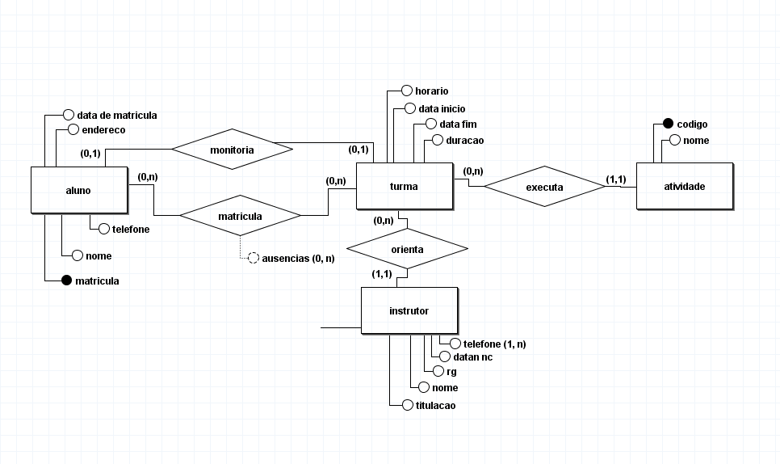
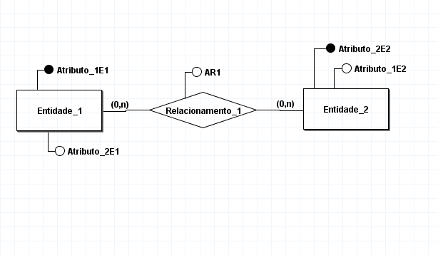
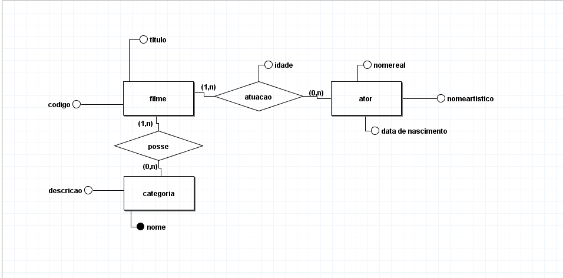
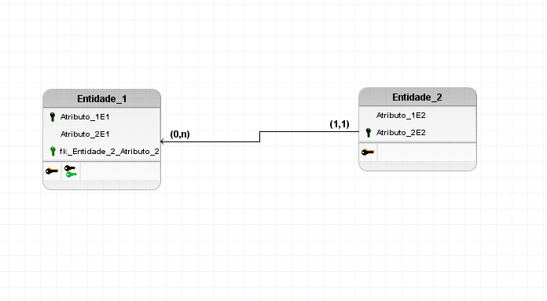
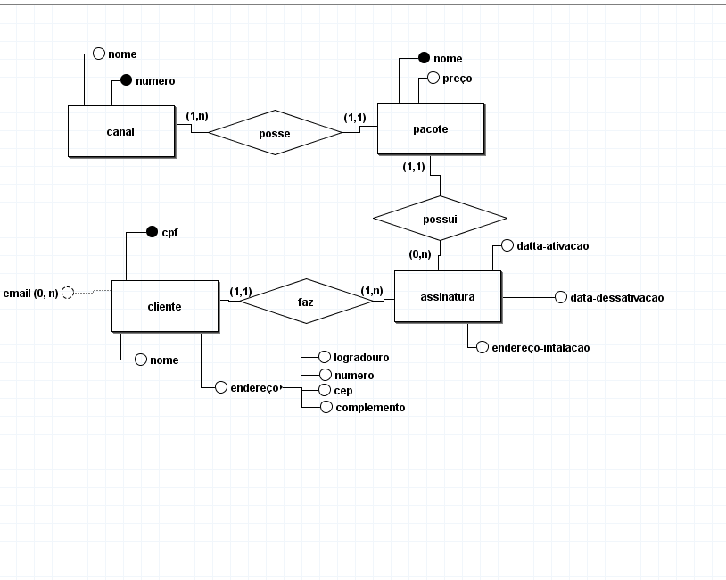

- Modelagem de Banco de Dados

Repositório criado para praticar conceitos de modelagem de dados conceitual e lógica utilizando a ferramenta **brModelo**. Além dos arquivos originais (`.brM3`), cada diagrama conta com sua visualização em imagem.

-- Diagramas incluídos

-- 1. Academia (`academia.brM3`)

-- 2. Modelo Conceitual 1 (`Conceitual_1.brM3`)

-- 3. Sistema de Filmes (`filme.brM3`)

-- 4. Modelo Lógico 1 (`Lógico_1.brM3`)

-- 5. Modelo Lógico 3 (`Lógico_3.brM3`)

-- 6. Modelo TV (`modelo tv.brM3`)

